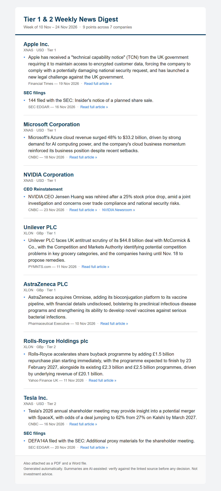

# Investor News Digest

[](https://github.com/rishanksingh-2005/investor-news-digest/actions/workflows/ci.yml)
[](LICENSE)

An investor-focused news digest for **your own watchlist** of listed companies.
Point it at your company list (Excel, CSV, JSON or a plain text file, with
whatever column names you already use). For every company it finds the latest stories from several sources,
reads each article, throws away the noise, merges duplicate coverage, summarises
each story into one bullet with an LLM, and publishes a clean **PDF and Word
(.docx)** report grouped by company, with every point linking back to its source.

Companies can be split into priority **tiers**; by default Tiers 1, 2 and 3 go
into a single combined digest.

```bash
pip install git+https://github.com/rishanksingh-2005/investor-news-digest
newsdigest --init-config                                # config.yaml with every setting explained
newsdigest --watchlist my_companies.xlsx --check        # see how your file is read
newsdigest --watchlist my_companies.xlsx                # build the digest (and email it, if set up)
```

From a source checkout, `python "news digest.py" …` and `python -m newsdigest …`
do exactly the same.

## What you get

A real, unedited run on 24 Nov 2026 over [ten well-known listed companies](docs/sample/watchlist.csv),
as it arrives by email. The same digest is attached as a [PDF](docs/sample/digest.pdf)
and a Word file. Companies with no material news that fortnight (Shopify, ASML and BP
here) are left out, and every point links to its source.

<p align="center">
  
</p>

On a phone it reflows to one column: [phone screenshot](docs/sample/sample-email-phone.png).
To reproduce it from a source checkout: `newsdigest --watchlist docs/sample/watchlist.csv`.

---

## How it works

| Step | What happens | Tech |
|---|---|---|
| 0. Load | Read your watchlist (any of .xlsx/.csv/.tsv/.json/.txt; columns auto-detected) | `openpyxl`, `csv`, `json` |
| 1. Discover | Find candidate stories per company | Google News RSS, SEC EDGAR, Finnhub |
| 2. Extract | Resolve each story to the publisher and read the article body: cache first, then plain HTTP, then Chrome | `urllib` / Selenium (Chrome) + BeautifulSoup, `trafilatura` as fallback |
| 3. Filter | Drop blocklisted, off-topic, stale, promotional, price-chatter and admin-filler stories | regex rules |
| 4. Dedupe | Collapse the same story reported by many outlets | `difflib` |
| 5. Summarise | One investor bullet per story, then group a company's points by topic | Ollama (default), OpenAI, Anthropic or local BART |
| 6. Publish | Build the PDF and DOCX with clickable source links | `reportlab`, `python-docx` |

Only step 5 uses AI. Everything else is plain code and public feeds.

**Discovery sources**

- **Google News RSS** for every company: a plain search, plus a `site:` search
  over trusted outlets (Reuters, FT, Bloomberg, WSJ, CNBC, the PR wires, …).
- **Official / regulated feeds per exchange**, also via Google News with `site:`
  filters: RNS/Investegate (UK), SEDAR+/Newswire (Canada), Actusnews (France),
  MFN/Cision (Sweden), EQS (Germany/Switzerland), MAYA (Israel), ASX (Australia),
  US PR wires, and more. See `EXCHANGE_SOURCES` in the script.
- **SEC EDGAR**: the company's own recent filings (8-K, 10-Q, …), for US listings only.
- **Finnhub**: company news for North American listings. Optional, and needs a
  free API key; it's skipped automatically without one.
- **GDELT** (optional, `--gdelt`): a free global news index that needs no key. It
  doesn't depend on Google, and its links go straight to the publisher, so they're
  read without Chrome. GDELT allows one request every 5 seconds, so it adds about
  6 seconds per company, and it switches itself off for the run if GDELT keeps
  rate-limiting. Off by default.

**Quality gates.** A story only reaches the report if it comes from a
non-blocklisted source, names the company in its headline or lead, carries a
material signal (earnings, M&A, guidance, contracts, leadership, regulatory…), is
not share-price/valuation chatter, consumer promo or routine RNS admin, is not
about an investor's stake in the stock ("fund keeps adding ASML"), is not another
company's newswire release that merely mentions it, and has a real readable article
body (not a paywall, consent stub or "are you a robot?" check). SEC filings are
described in plain words ("8-K: Results of operations", "144: Insider's notice of a
planned share sale"). Companies with nothing material are left out of the report.

**Page budget.** At most `max_articles_per_company` points per company and
`max_total_items` across the whole digest (about 8 pages), ranked by importance.
Every Tier-1 company keeps its best item.

If the chosen LLM is unreachable, the run never hangs: it falls back to an
offline summary built from the article's own lead sentences. With Ollama, the
model is loaded in the background while articles are being read, so the first
summary doesn't wait for a cold start. A timed-out call is retried once with
twice the time limit. After 3 failures in a row the LLM is switched off for the
rest of the run, so every remaining story doesn't wait out the timeout.

**Accuracy safeguards**

- **Number check.** Every figure in an AI-written bullet (amounts, percentages,
  counts) must appear in the source article, allowing for rounding and units
  (`£40.3m` supports `£40m`, `£1,234 million` supports `£1.2bn`, `22 percent`
  supports `22%`). A bullet with a figure that isn't in the article is replaced by
  the article's own sentences, and is never cached. Merged topic summaries get the
  same check against their member stories. In live testing this caught a bullet
  claiming "revenue climbed 7.9%" when the article contains no such figure. Turn
  it off with `verify_figures = False`.
- **Whole-word matching.** Keywords and company names match from the start of a
  word, so "order" no longer matches "border", "fine" no longer matches "finance",
  and "stake" no longer matches "stakeholder". Hyphenated keywords such as
  "half-year" match either spelling.
- **Constrained JSON.** Topic grouping asks the model for a fixed JSON format
  (Ollama and OpenAI support this). Small slips are repaired instead of the
  whole answer being thrown away: a forgotten story becomes its own point, and a
  repeated one is dropped.
- **Names, aliases, tickers.** A distinctive word of the name ("Xpel", "Douglas")
  is enough to match. A name made only of common words ("Watches of Switzerland",
  "North West Electricity", "Liberty Capital") must appear as the whole phrase,
  so a review of "the best watches of the year" doesn't count. Short names and
  former names go in the watchlist's **Aliases** column. A ticker of 3 or more
  letters written in capitals also counts (`PLOW`, `$PLOW`, `(NYSE: PLOW)`).
  The **Exclude** column drops stories about a different company with a similar
  name (for example "Rolls-Royce Motor Cars" for Rolls-Royce Holdings).
- **The article's own date.** Feed dates are sometimes the date a story was
  re-indexed, so an old story can look new. The date the article page gives in its
  own metadata is used instead whenever the two differ by more than a day, and
  stories that turn out to be old are dropped.
- **Duplicate detection by figures.** Two write-ups that share two specific
  figures ("22%" and "10%") are the same announcement, however differently
  they're worded. One shared figure isn't enough: two different £1bn contracts
  stay separate. Near-identical headlines are merged as well.

**Measured accuracy.** `eval/golden.json` holds hand-labelled cases: which
stories to keep for which company, which bullets have unsupported figures, and
which pairs are the same event. `python eval/evaluate.py` scores the rules
against them and lists every miss. The test suite (and therefore CI) fails if a
change makes any score drop below its threshold. Current scores: relevance 96%,
figures 100%, duplicates 90%. Add a case whenever you spot a real mistake.

**Run report and exit codes**

Each run ends with a health report: calls per source, stories read, how each
bullet was made, and an overall status. The report is also written to a log
file in `logs/`:

```
Run report
  Finnhub                            4 ok
  Google News                        7 ok
  SEC EDGAR                          4 ok
  bullets: AI (cached)               6
  bullets: replaced by number check  1
  Status: OK
```

The exit code tells a scheduler how the run went:

| Code | Meaning |
|---|---|
| `0` | OK. Published, or nothing material this window. |
| `1` | Failed. Watchlist problem, crash, or no stories from any source (usually a Google consent page, rate limit or no network). |
| `2` | Degraded. Published, but a source failed more often than it worked, Chrome didn't start, or the LLM was unreachable for most bullets. |

### Speed and caching

The run happens in phases, and each phase works through all companies in
parallel on a small thread pool. Discovery searches several companies at once.
Extraction uses the cheapest route that works:

1. **Cache.** A story already resolved and read in an earlier run is reused straight
   from `digest_cache.sqlite`.
2. **Plain HTTP.** Non-Google links (Finnhub, cached publisher URLs) are fetched
   directly, with no browser, 8 at a time.
3. **Chrome.** Only Google News redirect links, and pages HTTP couldn't read, open
   in Chrome, in several windows at once (`--browsers N`).

LLM summaries and topic groupings are cached per input and model, so a rerun
never pays for the same LLM call twice. If the LLM was unreachable, nothing is
cached and the next run tries again. Search results are reused for an hour.
Unreadable or paywalled pages are retried after a day.

Measured on Tier 1 (7 companies, 29 articles, local `llama3.2:3b`, headless):

| Run | Time |
|---|---|
| Previous version (sequential, no cache) | 664 s |
| This version, empty cache | 265 s (2.5× faster) |
| Same window again, cache filled | 10 s |

So reruns are near-instant, and a crashed or interrupted run can pick up where it
stopped: just run it again. `--new-only` uses the same cache to leave out stories that already
appeared in an earlier digest, which is handy for a daily run. `--no-cache`
ignores the cache and fetches everything fresh.

---

## Requirements

- **Python 3.10+**
- **Google Chrome.** Selenium downloads the matching driver automatically.
- **A summariser**, one of:
  - **Ollama** (default, free, local): install from [ollama.com](https://ollama.com),
    then `ollama pull llama3.2:3b`.
  - **OpenAI** or **Anthropic** API key (hosted).
  - **BART** (offline, no instructions/grouping): `facebook/bart-large-cnn`.

## Setup

### Option A: install the `newsdigest` command (recommended for users)

```bash
python -m venv digest-env
digest-env\Scripts\activate          # macOS / Linux: source digest-env/bin/activate
pip install git+https://github.com/rishanksingh-2005/investor-news-digest
```

Then work in a folder of your choice (one per client works well). Everything
the digest reads and writes lives in that folder: `config.yaml`, the watchlist,
`.env`, the cache, the reports and the logs.

```bash
mkdir client-a && cd client-a
newsdigest --init-config                  # config.yaml: every setting, explained
newsdigest --init-watchlist watchlist.xlsx
newsdigest --doctor                       # Chrome, LLM, watchlist, keys, email
newsdigest                                # build the digest
```

Set `NEWS_DIGEST_HOME` to use a different folder than the current one.

### Option B: run from a source checkout (for development)

**Windows (PowerShell)**

```powershell
cd "path\to\project"
py -m venv .venv
.venv\Scripts\Activate.ps1
python -m pip install -r requirements.txt
copy .env.example .env        # then fill in only the keys you need
```

**macOS / Linux**

```bash
cd "path/to/project"
python3 -m venv .venv
source .venv/bin/activate
python3 -m pip install -r requirements.txt
cp .env.example .env
```

Here the project folder is the home folder, and `python "news digest.py"` (or
`pip install -e .` for the `newsdigest` command) runs it.

Optional local BART summariser (~2 GB of extra packages):

```bash
pip install -r requirements-bart.txt        # or: pip install "investor-news-digest[bart]"
```

It uses the model in `NLP/` if that folder is present, and otherwise downloads
`facebook/bart-large-cnn` from Hugging Face on first use.

> A virtual environment is tied to the exact Python that created it. If you
> upgrade or reinstall Python, delete `.venv` and create it again. Typical symptoms
> of a stale venv: `No module named 'lxml.etree'`, `cannot import name '_regex'`.

### Your watchlist

Use the company list you already have. Supported files:

| Format | What it should look like |
|---|---|
| `.xlsx` / `.xlsm` | Any sheet with a header row. The first sheet that has a company-name column is used (or pick one with `--sheet`). The header doesn't have to be on row 1. |
| `.csv` / `.tsv` | Comma, semicolon, tab or pipe separated, detected automatically. A single column with no header works as a plain list of names. |
| `.json` | `[{"company": "...", "tier": 1}, ...]`, `{"companies": [...]}`, or just `["Name", "Name"]`. |
| `.txt` | One company per line; `#` starts a comment. |

Only a **company name** column is required. Everything else is optional, and
columns are recognised by common header names (case, spaces and punctuation
don't matter):

| Field | Recognised headers (examples) | Used for |
|---|---|---|
| name | Name, Company, Company Name, Issuer, Security Name, Entity | The search term. |
| tier | Tier, Priority, Group, Bucket | Selecting tiers (`1`, `1.0`, `Tier 1`, `T1`, `P1` all work). No tier column: every company is Tier 1. |
| exchange | Exchange, MIC, Market, Listing, Venue | Picks the official news sources. MIC codes (`XLON`) or common names (`NASDAQ`, `NYSE`, `LSE`, `AIM`, `TSX`, `ASX`, `Euronext Paris`, …). |
| country | Country, Domicile, Region | Used when the exchange is missing (`US` turns on SEC filings, `US`/`CA` Finnhub). |
| ticker | Ticker, Symbol, EPIC | Finnhub lookups; a 3+ letter ticker in capitals in a headline counts as a mention. |
| currency | Currency, CCY | Shown in the report. |
| aliases | Aliases, Alias, AKA, Other Names, Trading Names | Other names the company is reported under (`Jet2; Jet2.com`). Also searched for. Separate with `;` or `\|`. |
| exclude | Exclude, Exclusions, Negative Keywords | Terms meaning a story is about something else (`Rolls-Royce Motor Cars; Phantom`). |

Other columns are ignored. Spreadsheet error values such as `#VALUE!` and `#N/A`
count as empty, and duplicate company names are dropped.

If your headers are unusual, map them yourself:

```bash
newsdigest -w export.csv --map "name=Long Description,tier=Bucket" --check
```

**Getting started:**

```bash
newsdigest --init-watchlist watchlist.xlsx   # starter file (.xlsx, .csv or .json)
newsdigest -w watchlist.xlsx --check         # columns found, companies per tier, skipped rows
newsdigest -c "Rolls-Royce Holdings" -c "BAE Systems"   # no file at all
```

Where the watchlist comes from, in order: `--watchlist FILE`; the `WATCHLIST`
environment variable (handy in `.env`); `watchlist.xlsx`/`.csv`/`.json`/`.txt` or
`Company List.xlsx` in the home folder; and, in a source checkout, the bundled
`examples/watchlist.example.csv`, so a fresh clone runs out of the box. The
`watchlist` setting in `config.yaml` works too.

Real watchlists are client data, so `.gitignore` keeps `watchlist.*`,
`watchlists/`, `Company List.xlsx` and `config.yaml` out of the repository.

### Environment variables (`.env`)

Each user brings their own keys. Copy `.env.example` to `.env` and fill in only
what you need. `.env` is git-ignored, and keys are never printed or put in URLs.

| Variable | Needed for | How to get it |
|---|---|---|
| `ANTHROPIC_API_KEY` | `--provider anthropic` | [console.anthropic.com](https://console.anthropic.com) |
| `OPENAI_API_KEY` | `--provider openai` | [platform.openai.com](https://platform.openai.com/api-keys) |
| `FINNHUB_API_KEY` | Finnhub news source (optional) | Free at [finnhub.io/register](https://finnhub.io/register); the key is on your dashboard. |
| `SEC_USER_AGENT` | SEC EDGAR filings (US listings) | No sign-up. The SEC requires your name and email: `SEC_USER_AGENT=Jane Smith jane@example.com` |
| `WATCHLIST` | Default watchlist file, if you don't pass `--watchlist` | |
| `SMTP_PASSWORD` | Emailing the digest (see below) | Your mail provider. Gmail and Microsoft 365 need an *app password*. |
| `NEWS_DIGEST_CONFIG` | A settings file other than `config.yaml` | |
| `NEWS_DIGEST_HOME` | A home folder other than the current one | |

None are needed for the default Ollama run: without a Finnhub key, Finnhub is
skipped; without an SEC contact, EDGAR is still tried with a generic one, which
the SEC may throttle.

Notes on Finnhub:
- The free plan covers **US listings only**. Other markets return HTTP 403, so
  just that company is skipped and Finnhub carries on for the rest.
- The ticker comes from your watchlist's ticker column if it has one, otherwise
  Finnhub's symbol search.
- The free plan allows 60 calls a minute; a rate-limit reply is retried once.

**Check everything in one go:**

```bash
newsdigest --doctor
```

```
  [OK  ] Python               3.14.6
  [OK  ] Chrome               found
  [OK  ] Watchlist            112 companies in watchlist.xlsx
  [OK  ] Ollama               running, llama3.2:3b available
  [OK  ] Finnhub              key valid
  [OK  ] SEC EDGAR            contact set, EDGAR reachable
  [OK  ] Email                smtp.example.com:587 login OK; sends to 2 recipient(s)
```

It makes one cheap test call per key that is set (Finnhub, OpenAI, Anthropic,
SEC), logs in to the mail server without sending anything, and tells you exactly what to fix.

---

## Run

Make sure Ollama is running (`ollama list` should show `llama3.2:3b`), activate
the venv, then:

```bash
newsdigest                 # or, from a source checkout: python "news digest.py"
```

A Chrome window opens so you can watch, or dismiss a consent popup once. When the
run finishes, these files appear in the home folder (or `output_dir`):

```
news digest YYYY-MM-DD.pdf
news digest YYYY-MM-DD.docx
```

A large watchlist (100+ companies) takes a while on the first run. Use
`--tiers 1,2` for a faster pass; later runs reuse the cache.

### Command-line flags

| Flag | Effect |
|---|---|
| `--watchlist FILE`, `-w` | Your company list (.xlsx, .csv, .tsv, .json, .txt). |
| `--sheet NAME` | Excel sheet to read (default: first sheet with a company-name column). |
| `--map "field=Header,..."` | Map your own column headers (fields: name, tier, exchange, country, ticker, currency). |
| `--company NAME`, `-c` | Run for this company without a file (repeatable). |
| `--check` | Show how the watchlist is read (columns, tiers, skipped rows) and exit. |
| `--init-watchlist FILE` | Write a starter watchlist and exit. |
| `--doctor` | Check the setup and test your API keys, then exit. |
| `--schedule WHEN`, `--unschedule` | Run automatically (`07:00`, `"weekdays 07:00"`, `"mon,thu 18:30"`), or stop. See [Scheduling](#scheduling-optional). |
| `--config FILE` | Use this settings file (default: `config.yaml` in the home folder). |
| `--init-config [FILE]` | Write a starter `config.yaml` with every setting explained, then exit. |
| `--email-to ADDRESS` | Email the digest to this address (repeatable; replaces `email_to`). |
| `--no-email` | Don't email this run, even if `email_to` is set. |
| `--tiers 1,2,3` | Comma-separated tiers to include (default: all three). |
| `--tier 2` | A single tier only. |
| `--days 14` | Discovery window in days (default 14). |
| `--provider ollama\|openai\|anthropic\|bart` | Choose the summariser. |
| `--model NAME` | Override the model for that provider (for `bart`: a model folder). |
| `--headless` | Run Chrome invisibly. |
| `--no-trusted` | Skip the trusted-outlets search. |
| `--no-sec` | Skip SEC EDGAR filings. |
| `--no-finnhub` | Skip Finnhub. |
| `--gdelt` | Also search GDELT (free, no key, about 6 s per company). |
| `--new-only` | Leave out stories already published in an earlier digest. |
| `--no-cache` | Don't read or write the cache; fetch everything fresh. |
| `--browsers N` | Chrome windows to run in parallel (default 3). |

Examples:

```bash
newsdigest --tiers 1,2 --days 7 --headless
newsdigest --tier 1 --provider anthropic
newsdigest --config client-b.yaml --email-to analyst@example.com
```

### Configuration (`config.yaml`)

Every setting can live in a `config.yaml` in the home folder, so nobody has to
touch Python. `newsdigest --init-config` writes one listing every setting with
its default and an explanation; uncomment what you want to change:

```yaml
watchlist: watchlist.xlsx
tiers: [1, 2]
days_back: 7
llm_provider: anthropic

sources:                      # section names are optional, just for readability
  use_gdelt: true
  use_finnhub: false

email_to: [team@example.com]
smtp_host: smtp.gmail.com
smtp_user: digest@example.com
```

The order of precedence is built-in defaults, then `config.yaml`, then
command-line flags. Paths are relative to the config file. A mistyped setting
name stops the run with a suggestion (`unknown setting 'day_back' (did you mean
'days_back'?)`), so a typo never silently does nothing. API keys and passwords
stay in `.env`, never in `config.yaml`. One config file per client
(`--config client-a.yaml`) is an easy way to run several digests.
`examples/config.example.yaml` shows the full file.

The main settings:

| Setting | Default | What it does |
|---|---|---|
| `watchlist` | see above | Default watchlist file. |
| `default_tier` | 1 | Tier given to every company when the file has no tier column. |
| `days_back` | 14 | Discovery window (days). |
| `recency_grace_days` | 21 | Stories older than this are dropped. |
| `max_items_per_source` | 8 | Candidates pulled from each source. |
| `max_articles_per_company` | 2 | Points kept per company. |
| `max_total_items` | 40 | Global cap across the digest (~8 pages). |
| `min_importance` | 1 | Minimum material-signal score to keep a story. |
| `use_*` | on | Toggle each discovery source. |
| `llm_provider` | `ollama` | Default summariser. |
| `ollama_model` / `openai_model` / `anthropic_model` | `llama3.2:3b` / `gpt-4o-mini` / `claude-sonnet-4-6` | Model per provider. |
| `title_similarity`, `merge_*` | — | Dedupe / merge strictness (`merge_text_ratio` 0.7, `merge_headline_overlap` 0.6). |
| `use_gdelt`, `gdelt_min_interval` | off, 6 s | GDELT source and the spacing between its requests. |
| `llm_retry_on_timeout`, `llm_max_failures` | on, 3 | Retry a timed-out call once; switch the LLM off after this many failures in a row. |
| `ollama_keep_alive` | `30m` | How long Ollama keeps the model loaded after the warm-up. |
| `polite_delay` | 1.0 s | Pause between requests, so sites aren't hammered. |
| `discovery_workers` | 3 | Companies searched at once (Google rate-limits much above this). |
| `http_workers` / `browser_workers` / `llm_workers` | 8 / 3 / 2 | Parallel HTTP fetches / Chrome windows / LLM calls. |
| `http_fast_path` | on | Try plain HTTP before Chrome for non-Google links. |
| `use_cache`, `cache_path` | on, `digest_cache.sqlite` | The SQLite run cache. |
| `feed_cache_minutes` / `article_cache_days` / `failed_article_retry_hours` | 60 / 30 / 24 | How long each kind of cached item is reused. |
| `verify_figures` | on | Number check on AI bullets and summaries. |
| `log_dir` | `<output_dir>/logs` | Where run logs go (`""` turns logging off). |
| `email_to`, `email_from`, `email_subject` | none, `smtp_user`, `News digest {date}` | Who gets the digest, and the subject line (`{date}` `{tiers}` `{companies}` `{items}`). |
| `smtp_host`, `smtp_port`, `smtp_security`, `smtp_user` | none, 587, `starttls`, none | Your mail server. |
| `email_attach_docx`, `email_when_empty` | on, off | Attach the Word file too; email a short note when there was no news. |
| `email_show_warnings` | on | List run warnings at the foot of the email. Turn off when the email goes to clients. |

Source blocklist, relevance keywords and noise patterns are lists in
`newsdigest/patterns.py` (`SOURCE_BLOCKLIST`, `RELEVANCE_KEYWORDS`, …).

### Emailing the digest

Set `email_to`, `smtp_host` and `smtp_user` in `config.yaml`, and put the mail
password in `.env` as `SMTP_PASSWORD`. After each run the whole digest goes out
in the body of the email, laid out like the PDF and readable on a phone, with the
PDF (and Word file) attached. Mail apps that don't show HTML get the same digest
as plain text. Run warnings are listed at the foot unless `email_show_warnings`
is off. Any SMTP server works:

| Provider | `smtp_host` | `smtp_port` / `smtp_security` |
|---|---|---|
| Gmail / Google Workspace | `smtp.gmail.com` | 587 / `starttls` (needs an app password) |
| Microsoft 365 / Outlook | `smtp.office365.com` | 587 / `starttls` |
| SendGrid | `smtp.sendgrid.net` | 587 / `starttls` (user `apikey`) |
| Your own server | yours | 465 / `ssl`, or 587 / `starttls` |

`newsdigest --doctor` logs in without sending anything. A failed send never stops
the run: the reports are still written, and the run is marked degraded (exit code 2).

---

## Scheduling (optional)

One command sets up an automatic run, using your computer's own scheduler. Run
it in the folder you'd normally run the digest from:

```bash
newsdigest --schedule 07:00                 # every day at 07:00
newsdigest --schedule "weekdays 07:00"      # Monday to Friday
newsdigest --schedule "mon,thu 18:30"       # chosen days
newsdigest --unschedule                     # remove it
```

- **Settings and flags:** the scheduled run uses the folder's `config.yaml`, `.env` and
  watchlist. Any other flags you add are kept, for example
  `newsdigest --schedule 07:00 --tier 1`.
- **One schedule per folder:** each client folder can have its own. Running
  `--schedule` again in the same folder replaces that folder's schedule.
- **Checked first:** if the time or the watchlist is wrong, nothing is scheduled and you're told why.
- **Under the hood:** Task Scheduler on Windows, launchd on macOS, cron on Linux. It
  starts a small launcher script in the folder (`run-digest.cmd` or `run-digest.sh`).
  Each run's output goes to `logs/last-scheduled-run.txt`, with the full run log
  in `logs/` as usual.
- **Status:** `newsdigest --doctor` shows the next run time.

The computer has to be on at that time. On Windows a run missed while it was
asleep starts as soon as it wakes. Keep Ollama set to start at login. Set
`email_to` to have the digest arrive in your inbox. The exit code (0 OK,
1 failed, 2 degraded) is what the scheduler records.

A cloud scheduler can't reach a local Ollama, so there use `--provider openai`
or `--provider anthropic`.

---

## Troubleshooting

| Symptom | Fix |
|---|---|
| 0 articles for everyone | Google showed a consent wall. Run once without `--headless`, accept it, then rerun. |
| Bullets look like raw article sentences, plus `LLM bullet failed — using fallback` | The LLM wasn't reachable. Start Ollama (`ollama list`) or check your API key. |
| `[Finnhub] FINNHUB_API_KEY was rejected (HTTP 401)` | The key is wrong or was regenerated. Copy it again from your Finnhub dashboard into `.env`, then run `--doctor`. Or leave it empty / use `--no-finnhub`. |
| `[Finnhub] ... isn't covered by this key's plan (HTTP 403)` | Normal on the free plan for non-US listings; that company is skipped. |
| `[SEC EDGAR] failed: HTTP 403`, or the `SEC_USER_AGENT` warning | Set `SEC_USER_AGENT=Your Name you@domain.com` in `.env`. |
| A key in `.env` seems ignored | A variable already set in your system environment takes priority over `.env`. Remove the old one, or open a new terminal. |
| ChromeDriver errors | Update Chrome; Selenium 4 matches the driver automatically. |
| `can't open file … news digest.py` | Wrong folder, or the name isn't quoted. It has a space: `"news digest.py"`. Or install the package and use `newsdigest`. |
| `Config problem: … unknown setting` | A typo in `config.yaml`; the message suggests the right name. |
| `Email not sent: …` | Check `smtp_host` / `smtp_user` in `config.yaml` and `SMTP_PASSWORD` in `.env`, then run `--doctor`. Gmail and Microsoft 365 need an app password. |
| A company you expected is missing | It was filtered (price chatter / promo / admin filler), or nothing readable passed in the window. Try `--days 21`. If it's usually called by a short name ("WOSG", "Rolls-Royce"), add that to its Aliases column. |
| Stories about a different company with a similar name | Add the other company's name to the Exclude column. |
| `[GDELT] rate-limited twice` | GDELT allows one request every 5 seconds per client, and sometimes blocks a busy connection for longer. The run carries on without it. |
| `pip` not recognised (Windows) | Use `python -m pip …` with the venv active. |
| Results look stale, or a fixed page still shows as unreadable | Run once with `--no-cache`, or delete `digest_cache.sqlite`. |
| `feed failed: HTTP Error 429` | Google is rate-limiting. Lower `discovery_workers` to 1–2. |
| PC struggles during a run | Lower `--browsers` (each Chrome window uses ~200–400 MB). |
| `couldn't find a company-name column` | Rename the column to `Company`/`Name`, or use `--map name="Your Header"`. Check with `--check`. |
| `No companies found for the selected tiers` | Your tier values don't match `--tiers`. `--check` lists the tiers it found. |
| `.xls` not supported | Open it in Excel and save as `.xlsx` or `.csv`. |
| `number check: … not in the article` | The AI wrote a figure the article doesn't contain, so the article's own sentences were used instead. Working as intended. |
| A scheduled run "fails" with exit code 2 | It published, but something was degraded. The `!` lines at the end of the log say what. |

---

## Development

```bash
pip install -r requirements-dev.txt
python -m pytest          # ~355 tests, about 20 seconds
python eval/evaluate.py   # accuracy scores on the labelled cases, with every miss
ruff check .              # lint
```

The test suite runs **fully offline**: no Chrome, no LLM, no API keys and no
network. Feed and API calls are replaced with canned responses from
`tests/fixtures/`, and any unexpected network call fails the test. It covers
every pipeline stage: watchlist loading in every format (header detection,
column mapping, tier parsing, exchange names), Google News / SEC EDGAR / Finnhub
parsing (including retries and bad-key handling), article extraction, every
filter, dedupe and topic merging, the LLM fallbacks, the cache (expiry, reuse,
`--new-only`), the cache → HTTP → Chrome routing, the page budget, the PDF and DOCX
writers, the CLI, and a complete offline `run()` end to end.

**CI.** GitHub Actions (`.github/workflows/ci.yml`) runs `ruff`, the tests and the
accuracy scores on every push and pull request (Ubuntu on Python 3.10, 3.13 and
3.14, plus Windows), then installs the package and runs the `newsdigest` command
in an empty folder, the way a customer would.

## Project layout

```
newsdigest/             the package, one module per stage:
  watchlists.py           load the company list (any format)
  sources.py              1. discover (Google News, regulated feeds, SEC, Finnhub, GDELT)
  extraction.py           2. read articles (cache -> HTTP -> Chrome), page dates
  filtering.py            3. relevance, recency, noise, importance
  grouping.py             4. dedupe and topic grouping
  summarising.py          5. LLM / BART bullets, number check, LLM resilience
  publishing.py           6. PDF + DOCX
  delivery.py             email the digest
  scheduling.py           --schedule: Task Scheduler / launchd / cron
  pipeline.py             run(): the phases end to end
  cli.py                  command line and --doctor
  settings.py             the Config dataclass (every setting)
  configfile.py           config.yaml loading and the starter file
  patterns.py             source lists, keywords, text patterns
  storage.py, health.py   SQLite cache; run report and helpers
news digest.py          source-checkout launcher (same as `newsdigest`)
examples/               sample watchlist and config.example.yaml
docs/sample/            a real sample digest (PDF, email screenshots) and its watchlist
watchlist.xlsx / .csv   your own watchlist (not in git)
config.yaml             your own settings (not in git)
requirements.txt        core dependencies
requirements-bart.txt   optional local BART summariser
requirements-dev.txt    test + lint tools
pyproject.toml          package metadata, the newsdigest command, pytest and ruff
tests/                  offline test suite (+ fixtures/)
eval/                   labelled accuracy cases (golden.json) and the scorer
.github/workflows/      CI
.env.example            template for API keys (copy to .env)
NLP/                    optional local BART model (not in git)
digest_cache.sqlite     run cache, created on first run (not in git)
logs/                   one log per run, with the run report (not in git)
LICENSE                 MIT
```

## Limitations

- Google News RSS is unofficial and can rate-limit or change format.
- Paywalled outlets (FT, WSJ, Bloomberg) often fail the readable-body check, so
  the same story is usually taken from a free outlet instead.
- Relevance and noise filters are keyword rules: they're fast and transparent,
  but they aren't perfect. `python eval/evaluate.py` shows the known misses. For
  example, a company whose distinctive word is also an ordinary one ("Gamma")
  still matches "gamma ray" stories until you add an Exclude term.
- The duplicate check can't tell that two differently worded stories with no
  shared figures are the same event (for example "CEO to step down" and "boss to
  retire"). The LLM grouping step is what catches those.
- The number check verifies figures, not meaning. A bullet can quote only real
  numbers and still misstate what they refer to.
- With the default 3B local model, topic grouping is always valid JSON but not
  always good judgement: it can put unrelated points (results and a CFO change,
  say) under one heading. A larger model (`--model llama3.1:8b`, or
  `--provider openai`/`anthropic`) groups noticeably better.

*Summaries are AI-assisted. Verify against the linked source before making any
investment decision. Not investment advice.*

## License

[MIT](LICENSE)
